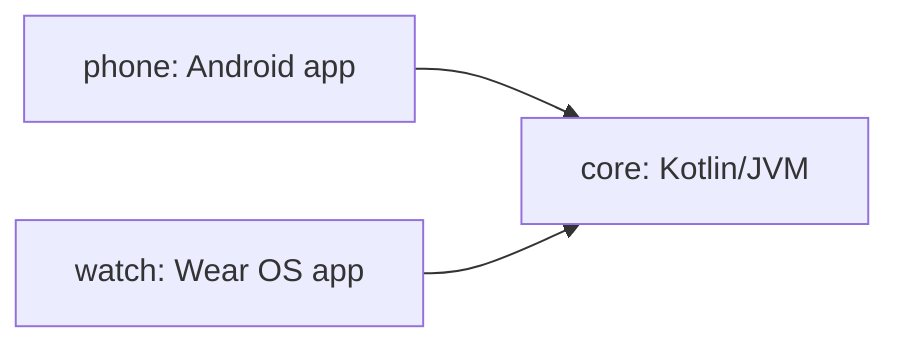

# Architecture

## Modules

| Project | Responsibility | Dependencies |
| --- | --- | --- |
| `core` | Shared SOS engine, Morse unit, control-state wire names | Kotlin/JVM and coroutines core |
| `phone` | Phone UI, preferences/repositories, Android torch/service/audio, Wearable adapters | `core` and Android libraries |
| `watch` | Wear UI, preferences/repositories, window/audio ownership, Wearable adapters | `core` and Wear/Android libraries |

`core` has no Android, Compose, Hilt, DataStore, or Google Play services dependencies. It does
not retain a context, own a coroutine scope, or start hardware work. Both apps call its SOS
engine from their existing signal sessions; the caller owns dispatching, cancellation and
final hardware/window cleanup. It uses JDK 21 for compilation with Java/Kotlin bytecode target 17,
matching the apps' target. It produces a library, not an installable APK.

The first extraction intentionally keeps platform-owned state and DataMap conversions in the
app modules. `ControlStateWire` contains only the existing path and field-name constants.
The phone decoder retains its defaults/validation, and the watch encoder retains its exact
DataMap value types and delivery timestamp. The existing independent wire fixtures continue
to validate those adapters.

## Source layout

- `core/src/main/kotlin/.../core/signal`: SOS timing and its shared 200 ms unit.
- `core/src/main/kotlin/.../core/sync`: control-state wire names.
- `core/src/test`: independent SOS timing/cancellation/failure tests and the unchanged CSV fixture.
- `phone/src/main` and `watch/src/main`: platform implementation and app-specific state/UI.
- `test-support`: shared test-only preferences fakes and independent wire fixtures, compiled
  into each Android app's JVM test source set. It is not a production Gradle module.
- `instrumentation-support`: shared Android test runner and device helpers, compiled into
  each app's `androidTest` source set. It is not a production dependency.

## Compatibility boundaries

The apps retain their application IDs, Android namespaces, manifest component names, preference
files/keys, saved enum ordinals, notification identifiers, and version metadata. Sharing the
implementation does not introduce a new synchronization protocol version. The wire schema is
still `/control_state` with the existing field names and types; older payload defaults remain
in the phone decoder. References in the tests are independent of the production constants.

The shared SOS engine preserves the existing timing algorithm and its cancellation contract:
the owning session performs the final off/cleanup operation. The timing fixture is an independent
reference and must not be regenerated from implementation output.

## Verification

Run `:core:test`, `:phone:testDebugUnitTest`, and `:watch:testDebugUnitTest`, then the existing
lint/APK checks. The manual Bitbucket pipeline includes all three JVM suites and captures the
core test XML/HTML reports. Its cloud run remains deferred while the user's Bitbucket issue is
being resolved; local Gradle and device verification are used during that interval.

The shared extraction is the first refactoring batch. Further app package separation and the
remaining repository/ViewModel type coupling should be handled in focused follow-up changes
after this module boundary is verified.

## References

- [Android modularization patterns](https://developer.android.com/topic/modularization/patterns)
- [Kotlin/JVM Gradle configuration](https://kotlinlang.org/docs/gradle-configure-project.html)
- [Testing](TESTING.md)
- [CI verification](CI.md)
