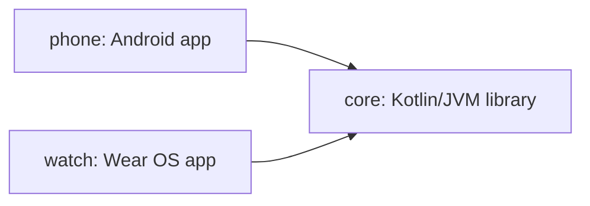

# Architecture

## Module boundaries

The repository has three Gradle modules, declared in [settings.gradle.kts](settings.gradle.kts):

| Module | Owns | Dependencies |
| --- | --- | --- |
| `core` | Shared palette, SOS timing, signal snapshots, connection/resume/command codecs and legacy wire names | Kotlin/JVM and coroutines core |
| `phone` | Phone UI, preferences, companion receiver, flashlight service and platform audio/torch adapters | `core`, Android and Compose libraries |
| `watch` | Wear UI, preferences, companion requests, local sound and window ownership | `core`, Wear/Android and Compose libraries |

`core` has no Android context, Compose, Hilt, DataStore or Play services dependencies. It does
not create coroutine scopes or own hardware. Callers supply execution, cancellation and cleanup.
All modules target Java/Kotlin bytecode 17; build toolchains use JDK 21.

`phone` and `watch` remain separate installable apps with separate version codes. Either can
be built and uploaded without uploading the other; Gradle includes the required shared library
code in each app. See [VERSIONING.md](VERSIONING.md).

## Source layout

- `core/src/main/kotlin/.../core/signal`: palette encodings, slider conversion and SOS engine.
- `core/src/main/kotlin/.../core/sync`: shared snapshots, codecs, status values and wire fields.
- `phone/src/main` and `watch/src/main`: platform components, repositories, ViewModels and UI.
- `core/src/test`, `phone/src/test`, `watch/src/test`: local JVM tests.
- `phone/src/androidTest` and `watch/src/androidTest`: Android integration tests.
- `test-support`: JVM fakes and independent fixtures, included only in app test source sets.
- `instrumentation-support`: runner and device helpers, included only in Android test source sets.

The two support directories are source inputs, not Gradle modules or production dependencies.

## UI and state

Activities host Compose screens and establish lifecycle ownership. ViewModels expose flows
for selections, readiness, timing and one-time UI events. Repositories own control state,
preference restoration, signal jobs and companion sessions. Hilt provides application-owned
platform dependencies; internal constructors allow tests to substitute scopes and adapters.

Controls distinguish selected modes from instantaneous output. For example, Blink can remain
selected while the current LED or screen phase is dark. Connection and sound icons describe
confirmed control/routing state, not proof that a hardware output is currently active.

Preference reads are asynchronous. Controls wait for readiness instead of blocking startup.
Restoration bounds invalid values and does not restart a saved torch session. Current and legacy
color encodings are interpreted through the shared palette; visible slider coordinates are
separate from stored positions. The watch commits remote color changes when the slider is released.

Phone control state still uses the main ViewModel's selection enum. Its saved ordinal order,
preference keys and DataStore filenames are compatibility boundaries during future refactoring.

## Lifecycle and resources

| Owner | Lifetime and cleanup |
| --- | --- |
| Phone Activity / main ViewModel | Creates controls before the first Compose draw. ViewModel clearing detaches companion listeners and requests torch shutdown. Home or a stopped Activity alone does not clear that ViewModel. |
| Watch Activity | Acquires one instance token with the control repository and phone-request handler in `onStart`; releases it in `onStop`. Each component ends shared work after its last owner leaves. |
| Phone control repository | Owns restoration, screen timing and legacy state collection. Cleanup cancels those jobs; independently queued preference writes can finish. |
| Watch control repository | Foreground ownership bounds screen timing, command delivery and reachability monitoring. A separate writer commits queued preferences in order. |
| Flashlight service | Owns foreground notification, LED timing and LED-associated sound. Shutdown cancels the active signal and attempts to turn the LED off. |
| Torch driver / session controller | Serializes camera-service writes. Ownership tokens prevent obsolete cleanup from switching off a newer session. |
| Sound players / signal screens | Sound wrappers track sample and stream handles separately. Screens restore brightness when they release window ownership. |

Blinking and SOS hold a partial CPU wake lock through their final torch-off cleanup attempt.
Cleanup runs without coroutine cancellation, and lock release is attempted even if the off-write
fails. Steady LED output does not hold this timed-signal lock. The Activity's keep-screen-on flag
is separate and does not keep the CPU awake after the display is turned off.

The service can maintain a requested phone LED signal while the Activity is in the background.
Finishing the Activity and clearing its ViewModel requests shutdown. Watch foreground cleanup
stops local screen/sound work and pauses the remembered phone relationship. These lifecycle
contracts do not promise recovery after Android force-stop or every manufacturer restriction.

## Threading

- Android lifecycle callbacks, UI events and repository state changes run on Main.
- ViewModel work uses `viewModelScope`; watch foreground work uses an explicitly owned session scope.
- The phone transport also guards registration and session transitions with a listener lock.
- Wearable tasks suspend while awaiting results; transport completion is not a reason to move UI
  mutations to IO. Watch transport calls run in their caller's coroutine.
- Torch hardware writes run on IO under a mutex. The phone torch-availability query also uses IO
  from its ViewModel.
- DataStore owns its storage dispatching. Preference writers have a lifetime separate from
  cancellable signal sessions; the watch writer uses IO.
- SoundPool methods and asynchronous load callbacks share a lock. Stopping clears pending play
  requests so a late callback cannot restart a stopped sound.

## Phone and watch communication

Google Play services carries discovery, companion launch, RPC requests and legacy DataItems.
The apps verify modern control requests against the sender, advertised capability, current
registration, restored readiness and session state. A capability or cached node ID alone is not
authorization to apply a command.

### Connection and state transfer

| Event | State direction / result |
| --- | --- |
| Phone starts synchronization | Launch the watch, confirm a handoff and import the complete phone configuration on the watch. |
| Watch connects to a new phone | Confirm a handoff and send the watch configuration to the phone. |
| Watch reconnects to the last phone | Read current phone settings through `handoff_state`; do not apply standalone watch settings. |
| Remembered link resumes | Negotiate a replacement command session and import the phone state before activating control. |
| User acts on the linked watch | Send the complete watch configuration captured for that action. Apply its mode, output, color, frequency, sound and screen selection together. |
| User acts locally on the phone | Apply locally. Do not continuously mirror edits to the watch; a later watch action can replace them. |
| User explicitly disconnects | Revoke the live relationship and disable automatic resume. The disconnect request does not itself turn off the phone signal. |

This is a watch-control model with state transfer at handoff and reconnect, not continuous
two-way synchronization. Connection/status checks carry no signal configuration and do not
overwrite local edits. The watch sends user actions in order; edits made during a pending
handoff are replayed against the imported baseline in tap order.

The phone validates the sender, session ID, increasing sequence, timestamp and action/snapshot
consistency before applying modern commands. Decoding checks layout and value bounds; freshness
and authorization remain separate receiver checks.

### Interruptions and recovery

- Stopping the watch's final foreground owner pauses control but retains the remembered link.
  Reopening starts monitoring and can resume that relationship.
- Phone ViewModel cleanup pauses the remembered relationship. When phone controls become
  available again, availability messages and watch monitoring can resume it.
- Physical connection loss pauses delivery and clears the connection indicator after detection.
  Resume attempts use bounded retry delays while the watch session remains active.
- Explicit disconnect is different: reopening or restoring radio connectivity must not reconnect
  automatically. The watch retains only a last-phone routing hint for the next explicit attempt.
- A locked or stopped phone Activity can accept a verified handoff once controls are ready.
  Activity creation initializes them before the first draw; the app does not dismiss keyguard.

Reconnection is asynchronous. The icon indicates a confirmed session, not merely an installed
companion or paired radio. A pause retains local sound suppression; an explicit offline sound
choice can enable watch playback. A successful reconnect imports phone settings and routes
linked sound back to the phone.

### Protocol compatibility

- Shared `ControlStateWire` retains the legacy `/control_state` field names and types. Phone
  decoding supplies bounded defaults; watch encoding provides backward-compatible color values.
- Modern phone RPC paths remain under `/light_signals/phone/v3/`. App version `v5.0.0` does not
  rename that protocol.
- The original 37-byte command layout remains supported. New state-bearing actions use the
  `control_state` endpoint with an attached correlated snapshot.
- Empty replies from an unsupported new action endpoint permit the old per-control path.
  Rejection or timeout does not trigger that fallback. A malformed state-read reconnect reply
  does not justify overwriting phone settings with the watch profile.
- Before importing a phone profile, the watch keeps an in-memory standalone backup. While that
  backup exists, linked edits do not overwrite standalone preferences. Linked settings and
  relationship identity are saved separately; explicit disconnect restores standalone controls.

Wire compatibility tests do not replace mixed-version paired-device testing. See
[TESTING.md](TESTING.md#remaining-coverage).

## Entry points, permissions and builds

The phone Quick Settings tile opens the controls page; it does not toggle the LED directly.
The Activity consumes its navigation extra once and waits until the pager can handle it.
Android 13+ can show the system add-tile flow; older versions show manual guidance.

Torch control uses the camera service without declaring camera permission. Notification access
is optional and requested separately on Android 13+. A grant refreshes the active foreground
notification; denial leaves LED selection unchanged. The service uses `specialUse` on Android 14+.

`release` and `releasecheck` enable R8 code/resource optimization. Each module's
`src/main/keepRules/horologist-protobuf.keep` preserves fields accessed reflectively during
companion RPCs. `releasecheck` uses the isolated test app ID and debug signing; it does not prove
production signing or a Play-installed upgrade.

See [TESTING.md](TESTING.md) for validation, [CI.md](CI.md) for GitHub verification and migration status, and [VERSIONING.md](VERSIONING.md) for independent uploads.
